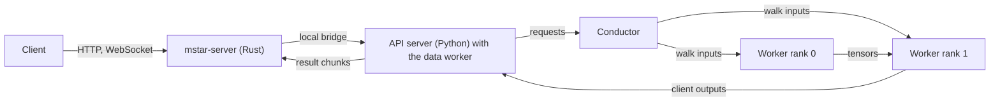

M* runs a model as a graph of components and each request as a sequence of walks over that graph. A YAML config decides which GPU runs each component, so the same model code serves on one GPU or many.

## Processes {#processes}

`mstar serve <model>` starts one deployment on one machine. It builds the arguments for `mstar-serve` (`mstar.api_server.entrypoint:main`) and calls it.

| Component | Code | Role |
|---|---|---|
| HTTP frontend | `rust/server/`, the `mstar-server` binary | Serves the HTTP and WebSocket routes, translates OpenAI requests and streams results. It talks to the API server over a local ZeroMQ bridge (`mstar/api_server/rust_frontend.py`). `--python-frontend` serves from the deprecated FastAPI app instead. |
| API server | `mstar/api_server/` | Holds a copy of the model without weights, spawns the conductor, waits for the workers, runs the config's `warmup_requests`, then starts `mstar-server`. |
| Data worker | `mstar/api_server/data_worker.py` | A thread in the API server. It loads media, calls the model's `process_prompt` to turn a request into tensors, and calls `postprocess` on the outputs the workers send back. |
| Conductor | `mstar/conductor/` | One process. It validates the deployment, spawns the workers, picks a replica for each request, runs the request's walk plan and detects completion. |
| Worker | `mstar/worker/` | One process per rank, usually one per GPU: the micro-scheduler (continuous batching), admission and preemption, speculation, and the engine. |
| Engine | `mstar/engine/engine.py` | Inside each worker. It compiles forwards, captures accelerator graphs, batches rows and drives each step's admit, plan, forward and commit. |
| Graph runtime | `rust/src/graph/`, wrapped by `mstar/graph/runtime/rust.py` | Inside each worker: graph state, readiness, routing and speculation, and the frames that carry results to other workers and the API server. It is the only graph runtime. |

Control messages go over a ZeroMQ mesh in the Rust extension (`mstar/communication/rust_communicator.py`). Tensors go over the transport that `--tensor-comm-protocol` selects: `SHM` (shared memory, the `mstar serve` default), `TCP` or `RDMA`. `TCP` and `RDMA` run on the Mooncake transfer engine, and `RDMA`, the `mstar-serve` default, needs an RDMA fabric. A control message carries descriptors (`TensorPointerInfo`) that name the worker or API server holding each tensor, and the receiver reads the bytes from there, so tensors never pass through the conductor.

Nothing serves until setup is done: the workers load weights, compile and capture, the API server checks its declarations against the conductor's, the warmup requests run, and only then does the frontend bind. See [Cold start](/cold-start).

## Graph walks {#graph-walks}

A node is one submodule of the model: a vision encoder, an LLM, a diffusion head, an audio codec. Edges carry named tensors from node to node, or to the client.

A walk is a named path through the nodes. `Model.get_graph_walk_graphs()` returns one graph per walk, built from `GraphNode`, `Sequential`, `Parallel` and `Loop`, with `GraphEdge` outputs (`mstar/graph/base.py`). A text model has a prefill walk over the prompt and a `decode` walk, a `Loop` that feeds each sampled token back into the LLM; BAGEL has nine walks, including ViT and VAE prefills and a flow-matching loop. A model that knows a loop's count at ingest, such as a number of denoising steps, returns it from `Model.get_loop_caps()` and the loop ends there.

For each request the conductor asks the model once, at ingest, for a walk plan per partition. `Model.walk_plan()` returns the walks to run in order, such as `prefill` then `decode`, as `WalkStep`s (`mstar/conductor/request_info.py`). The conductor sends each walk its inputs and moves on when the workers report it done. A plan that raises `ValueError` refuses the request with a 400.

A partition is a set of walks that advances on its own. Orpheus has two (`mstar/model/orpheus/orpheus_model.py`): `LLM` runs `prefill` and `decode`, and `SNAC` runs `snac_chunk`, which turns windows of new tokens into audio as the LLM decodes. Partitions exchange data on streaming edges (`StreamingGraphEdge` and `Connection` in `mstar/streaming/topology.py`). The consumer buffers the items in a `StreamBuffer`, and a chunk policy (`mstar/streaming/chunk_policy.py`) decides when its node gets the next chunk. A `Connection` from the `client` partition is a client input stream, such as the caller's audio in Nemotron VoiceChat.

While a worker runs step N on the GPU, it builds and plans step N+1 for the rows that continue, on a separate thread and stream (`mstar/worker/speculation.py`). A node opts out with `enable_async_scheduling=False` on its `GraphNode`. Nodes split over several ranks speculate too, unless `MSTAR_TP_ASYNC_SCHED` or the config's `tp_async_sched` turns it off (`mstar/worker/lockstep.py`).

## State {#state}

A model declares the state its nodes keep between steps in `Model.declare_state()`, using only the names in `mstar.engine.state.__all__` ([`mstar/engine/state/__init__.py`](https://github.com/mstar-project/mstar/blob/main/mstar/engine/state/__init__.py)). An `Array` holds per-request entries, such as a KV cache, and its reads take a mask (`Causal`, `Window`, `Block`, `Bidirectional`) and optionally the `Attend` op. A `Value` keeps one entry per request, such as a linear-attention state, which its `updates` ops (`GatedDeltaNet`, `Mamba2`, `CausalConv`) overwrite in place. A `Sampler` draws tokens, and a `SeqShard` lets a node's steps split over its sequence-parallel ranks.

The engine builds the resources from those declarations (`mstar/engine/state/adapters.py`): paged KV and the attention planned over it, recurrent state pools, position tables and samplers. Each submodule receives its node's handles by declared name through `bind_state`, and its layers call them in the forward (`add_read`, `rope`, `sample`, `gated_delta_net` and the other calls exported there). A node that declares nothing receives nothing, as VAE encoders, codec decoders and projection stages do.

CI holds every new model package to this contract: `test/modular/test_state_lint.py` fails a package that is not in `PORTED`, imports the engine other than through `mstar.engine.state`, or writes its own resource specs. `get_node_resources` remains in the nine older packages on `UNPORTED` there and in one listed exception, MiniMax-H3's video decoder. [State contract](/contributing/state-contract) lists every declaration and what the engine builds from it.

## Accelerator graphs {#accelerator-graphs}

The engine compiles a submodule's forward with `torch.compile` and captures it as an accelerator graph, a CUDA graph on `cuda` devices or an XPU graph on Intel GPUs (`mstar/engine/accelerator_graph_backend.py`). A submodule opts in by returning a `BatchedAcceleratorGraphConfig` (a batch of rows) or `PackedAcceleratorGraphConfig` (packed tokens) from `get_accelerator_graph_configs()`, or, for an inner loop such as a ViT's blocks, a `PiecewiseBatchedConfig` or `PiecewisePackedConfig` from `get_piecewise_accelerator_graph_configs()` (`mstar/engine/accelerator_graph_config.py`). A step is padded to one of the captured batch sizes and replayed.

Capture happens in each worker at startup (`Engine.warmup()`), before the server binds. `mstar serve -O0`, `-O1` (the default) or `-O2` sets `MSTAR_COMPILE_LEVEL`, which chooses how hard Inductor tunes (`COMPILE_LEVELS` in `mstar/engine/accelerator_graph_runner.py`). Inductor's and Triton's caches live under `~/.cache/mstar/torchinductor` unless `TORCHINDUCTOR_CACHE_DIR`, `TRITON_CACHE_DIR` or `XDG_CACHE_HOME` says otherwise (`mstar/engine/__init__.py`), so a restart that keeps that directory reuses the compiled kernels. See [Cold start](/cold-start).

Captured or eager, a step goes through the same lifecycle. The submodule declares what the step does to its state in `NodeSubmodule.declare_step()` (`mstar/model/submodule_base.py`). The engine's `StepRunner` (`mstar/engine/resources/runner.py`) admits the step, which reserves pages and slots, plans it, and commits it after the forward; model code makes none of these calls itself. A step that cannot be admitted becomes backpressure that the scheduler resolves by waiting or preempting, not an error inside a forward pass.

## Placement {#placement}

A config's `node_groups` map nodes to ranks, and the model code does not change between placements. `configs/bagel_single_gpu.yaml` puts BAGEL's four nodes on rank 0, and `configs/bagel_cfg_parallel.yaml` adds `combine_cfg` on rank 0, `LLM_cfg_text` on rank 1 and `LLM_cfg_img` on rank 2 for the CFG walks. [Serving](/serving#placement) walks through both.

| In a `node_groups` entry | Effect |
|---|---|
| `node_names`, `ranks` | Which nodes run on which ranks. Several groups may share a rank. |
| `graph_walks` | Limits the group to those walks, so a node can run on different ranks in different walks. |
| `tp_size`, `sp_size`, `cfg_size` | Splits the node over a lockstep instance of `cfg_size * sp_size * tp_size` ranks: tensor parallel over weights and heads, sequence parallel over the tokens, CFG parallel over the guidance branches (`mstar/distributed/base.py`). |
| `ep_config` | With `parallel: ep`, a MoE node's routed experts are split over its TP ranks (`configs/qwen3omni_thinker_ep2.yaml`). |
| More ranks than one instance | Data parallel: each instance is a replica, and the conductor picks one per request by its load and predicted prefix hit (`mstar/conductor/routing.py`). |

Top-level `rank_devices` puts several ranks on one GPU, and `mps: true` runs those workers under CUDA MPS so their kernels overlap (`configs/whisper_large_split.yaml`). The ranks of a lockstep instance run the same steps and collectives in the same order (`mstar/distributed/communication.py`): rank 0 makes the scheduling, admission and eviction decisions, and the other ranks replay them (`mstar/worker/lockstep.py`).

Each paged KV pool admits a request when the pages for its prompt fit beside the reservations already admitted, and queues it otherwise (`mstar/worker/admission.py`). When a running request needs a page and none is free, the worker takes pages from newer requests. Each one moves to the host pool (`cpu_offload_pages`) when that pool can hold all of its pages, and is otherwise dropped and later rebuilt from its token ids, if they can rebuild its KV (`mstar/worker/preemption.py`, `mstar/worker/rebuild.py`). A request that streams an output listed in `unpausable_outputs`, audio by default, reserves its whole footprint and is never preempted. `max_concurrent_requests` caps how many requests run at once. The design is in [Preemption under KV pressure](https://github.com/mstar-project/mstar/blob/main/docs/design/admission_and_preemption.md). The top-level keys are in [Deployment config](/reference/config), and the `resources:` keys of a pool in [Config files](/serving#config-files).

A paged KV pool keeps the pages of finished requests in a prefix index, so a later request with the same prefix skips recomputing them (`mstar/engine/resources/kv/prefix_index.py`). It is on by default for a pool on one rank, and `prefix_cache: false` on the pool under `resources:` turns it off. Above one rank it needs `prefix_cache_tp: true` (`keeps_prefix_cache` in `mstar/engine/resources/kv/config.py`).

Code that branches on hardware asks `mstar.platforms.current_platform` (`is_rocm()`, `arch()`, `has_cuda_capability()`), which resolves NVIDIA, AMD, Intel XPU or CPU once per process (`mstar/platforms/__init__.py`). Hardware-specific kernels sit inside resources, such as `XPUPagedAttentionManager` on Intel GPUs. [Supported hardware](/hardware) lists what is tested.

Before any worker starts, the conductor checks the model against the YAML with `validate_deployment` (`mstar/validation/__init__.py`) and raises one error listing every problem. Each process hashes the model's declarations (`declaration_digests` in `mstar/engine/state/analysis.py`), and a worker or API server whose hashes differ from the conductor's refuses to start.

## Process failures {#process-failures}

A dead worker sends nothing, so the conductor checks the worker processes twice a second, during startup and while serving (`_poll_worker_liveness` in `mstar/conductor/conductor.py`), and the API server checks the conductor the same way. A dead worker is fatal for the deployment.

| Failure | What happens |
|---|---|
| A worker exits, is killed or crashes | The conductor logs the worker, its pid, its exit code or signal and the nodes it hosted, fails every waiting request with a 503 that names it, terminates the other workers and exits non-zero. |
| The conductor exits before the workers are ready | The API server never binds and exits non-zero. |
| The conductor exits while serving | The API server fails pending requests with a 503, refuses new ones, stops the HTTP frontend and exits non-zero. |
| The conductor is killed outright | Each worker watches its parent and exits, so none is left holding GPU memory. |
| The API server is killed outright | The conductor watches its parent the same way and takes the deployment down. |
| `mstar-server` crashes, is killed or loses its port | The API server stops the deployment and exits with status 3. |

SIGINT and SIGTERM shut the deployment down normally.
