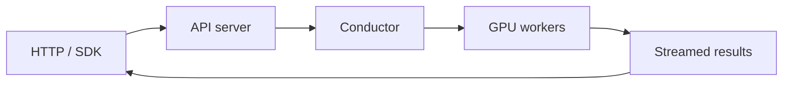

M\* (M-star) serves composite multimodal models, built from components such as vision encoders, transformer backbones, diffusion heads, audio codecs and action generators, with text, image, audio, video and robot actions in and out. Each model is a dataflow graph of its components, each request is a walk over that graph, and a YAML config places the components on GPUs.

<CardGroup cols={2}>
  <Card title="Quickstart" icon="bolt" href="/quickstart">
    Install from source, serve BAGEL and send a first request.
  </Card>
  <Card title="Supported models" icon="table" href="/models">
    Every model key with its GPUs, extra and endpoints.
  </Card>
  <Card title="Serving" icon="server" href="/serving">
    Custom configs, GPU placement, API keys and tensor transport.
  </Card>
  <Card title="Architecture" icon="diagram-project" href="/architecture">
    Processes, graph walks, state and accelerator graphs.
  </Card>
</CardGroup>

## From request to result {#from-request-to-result}

`mstar-server` serves the HTTP routes for the API server, which prepares each request and streams results back. The conductor runs each request's graph walks across the workers. Each worker runs the components placed on its GPU through an engine that batches requests, manages their state and captures accelerator graphs. [Architecture](/architecture) has the details.
